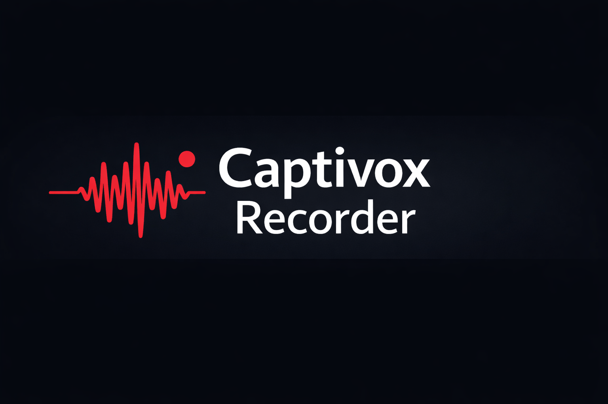

# Captivox Recorder



**A free Windows app that records your conversations and transcribes them on your own PC.**

Captivox Recorder records your microphone and your PC's audio at the same time (Teams, Zoom, Google Meet or any other app), then turns the conversation into text in the background with [WhisperX](https://github.com/m-bain/whisperX). Everything happens on your own computer: no cloud, no account, no telemetry.

- Version: **2.0.2** (October 2026)
- Licence: [GPL-3.0](LICENSE)
- Runs on: Windows 10 and 11 (64-bit)
- Languages: the interface is in English, Dutch, German or French; transcription in Dutch, English, German, French, Spanish, Italian, Chinese and Japanese

## Why Captivox

I work in information security and spend a lot of my week in meetings. I wanted a way to transcribe those conversations and get the useful parts out of them afterwards: action items, minutes, decisions. What I did not want was to upload recordings of meetings to a cloud service. Conversations are full of personal and confidential information, and in my line of work that is exactly the kind of data you keep close.

I couldn't find a tool that did all of this entirely on my own PC, so I built one for myself. Captivox Recorder is the free part of that work, shared in the hope that it is useful to others too. Captivox is made in the Netherlands.

## What it does

- **Clear layout**: four pages on the left: *Today*, *Meetings*, *Notifications* and *Settings*, plus a page about Captivox Pro. *Today* shows what needs your attention and a big record button; *Meetings* lists all your conversations, with search and the transcript right next to it.
- **Your language**: the interface is in English, Dutch, German or French. The installer uses the language you pick during setup; change it later under *Settings*, *General* (it takes effect after a restart).
- **Recording**: your microphone and your PC's audio at the same time, with a level meter for each source. Every recording gets its own folder.
- **Speech-friendly mix**: both sources are merged into one clear recording (16 kHz mono), tuned for speech recognition.
- **Transcription**: starts automatically when you stop recording, using Whisper (`large-v2` on an NVIDIA card, `large-v3-turbo` otherwise). Choose the language of the conversation: Dutch, English, German, French, Spanish, Italian, Chinese or Japanese.
- **Graphics card support**: NVIDIA cards via CUDA, set up automatically. Otherwise, including with an AMD card, Captivox transcribes on the processor (CPU) at low priority with the faster `large-v3-turbo` model, so your PC stays usable and the text stays accurate. With an AMD card you can choose *Fast on the graphics card (AMD)* under *Settings*, *Recording*: much faster through Vulkan, but less accurate.
- **Import existing files**: transcribe an existing recording (wav, mp3, m4a, aac, mp4) with *Import audio* on the *Meetings* page.
- **Afterwards**: read the transcript, copy it, save it as `.txt`, `.srt` or `.vtt`, give the conversation a name, transcribe it again with different settings, or move it to the Recycle Bin.
- **Notifications**: a Windows notification when a conversation has been transcribed or when something went wrong; the latest notifications are also listed in the app.
- **Stays out of the way**: runs in the system tray; start and stop recording with **Ctrl+Shift+F9**, show or hide the window with **Ctrl+Shift+F10**. It can start with Windows if you like.
- **Keeps an eye on the recording**: warns you if the microphone has been silent for minutes, if an audio device disappears, or if the recording is getting too large.
- **Clean-up** (optional, off by default): delete old recordings and transcripts after a number of days you choose.

## Privacy in short

- No account, no telemetry, no cloud. Recordings and transcripts are stored in your own user folder (`%USERPROFILE%\Captivox\Opnames`).
- An internet connection is only needed during installation, when Captivox downloads Python, FFmpeg, the Python packages and the speech models, and the first time you switch to another language (a small model for the timestamps in that language).

More details in [PRIVACY.md](PRIVACY.md).

**Be open when you record.** Let the other people in the conversation know that you are recording and why. A recording with voices and names is personal data: don't keep it longer than you need to, and don't share it casually.

## Requirements

- Windows 10 or 11, 64-bit.
- About 10 GB of free disk space (about 15 GB with an NVIDIA graphics card) for the transcription runtime and the speech models, plus room for your recordings (about 2 MB per minute after mixing). The installer checks this first.
- An internet connection during installation.
- Preferably an NVIDIA graphics card. It also works on the processor alone: Captivox then uses the faster `large-v3-turbo` model at low priority and leaves a few processor cores free, so you can keep working while it transcribes; it just takes longer than with a graphics card.

## Install

1. **Download** `CaptivoxRecorder-2.0.2-setup.exe` from [Releases](https://github.com/rgerr/captivox-recorder/releases). If you like, check the SHA-256 against the `.sha256` file next to it:
   ```powershell
   Get-FileHash .\CaptivoxRecorder-2.0.2-setup.exe -Algorithm SHA256
   ```
2. **Install**: double-click the file. The app is not digitally signed, so Windows SmartScreen may show a warning. If it does, choose *More info* and then *Run anyway*. No administrator rights are needed: Captivox is installed in `%LOCALAPPDATA%\Programs\CaptivoxRecorderFree`, with a shortcut in the Start menu.
3. **Let it set itself up**: the same installer then downloads and sets up everything Captivox needs to transcribe, in its own folder: a private Python, FFmpeg, WhisperX and the speech models. You don't need to install anything else, and nothing is installed system-wide. This downloads about 5 GB (about 9 GB with an NVIDIA graphics card) and takes 10 to 30 minutes; a progress bar shows how far it is. Before it starts, the installer checks that there is enough free disk space (about 10 GB). There is no PowerShell window and nothing to answer.
4. **Graphics card**: Captivox picks the route itself. With an NVIDIA card it uses CUDA; otherwise it transcribes on the processor, at low priority and with a faster model. With an AMD card, the installer also prepares and tests the fast route through the graphics card (Vulkan), which you can turn on yourself under *Settings*, *Recording*.
5. **Choose your devices**: in *Settings*, *Recording*, pick your microphone and the device you hear the other people on (usually your headset or speakers). Then press **Start recording**.

**Repair or update**: run the setup again. It keeps what is already in order and only downloads or repairs what is missing. A new version installs over the old one; your recordings and settings stay where they are.

**Portable version.** Prefer not to install? Download `CaptivoxRecorder-2.0.2-win-x64.zip` (also with a `.sha256` file), extract it to a folder you can write to, and run these two commands once in PowerShell in that folder (there is no installer to do it for you). The script downloads and sets up the same things as the installer:

```powershell
Get-ChildItem -Recurse | Unblock-File
powershell -NoProfile -ExecutionPolicy Bypass -File .\install-prereqs.ps1
```

Then start `CaptivoxRecorder.exe`.

**Uninstall** through Windows, *Apps*, *Captivox Recorder Free*. Your recordings are kept; Captivox asks whether the transcription runtime and the settings should be removed as well. The downloaded speech models stay in `%USERPROFILE%\.cache\huggingface`.

## How it works

```
CaptivoxRecorder.exe                         workers\captivox_transcription_worker.ps1
  records microphone + PC audio (WASAPI)       watches for folders with a READY file
  mixes to audio_mix.wav (16 kHz mono)    ->   claims the recording
  writes manifest.json and READY               runs WhisperX through Python
                                               writes transcript.txt and transcript.json
```

Every recording is an ordinary folder that you can open, copy or delete yourself:

| File | Contents |
| --- | --- |
| `audio_mix.wav` | the recording |
| `manifest.json` | status of the recording and the transcription |
| `session.log` | log of the recording |
| `transcript.txt` | the transcribed conversation |
| `transcript.json` | the transcript with timestamps for each segment |
| `exports\` | subtitles (`.srt`, `.vtt`), if you turn them on |

The app's own settings and logs are stored in `%LOCALAPPDATA%\CaptivoxRecorderFree`.

## Build from source

You need the [.NET 8 SDK](https://dotnet.microsoft.com/download/dotnet/8.0), and for the installer [Inno Setup 6](https://jrsoftware.org/isinfo.php) (or build with `-SkipInstaller`).

```powershell
powershell -NoProfile -ExecutionPolicy Bypass -File .\build.ps1
```

The output goes to `dist\`: a folder and a zip with a self-contained `CaptivoxRecorder.exe` (no .NET installation needed), the worker and the helper scripts, plus the installer `CaptivoxRecorder-<version>-setup.exe`, each with a SHA-256 checksum.

| Folder | Contents |
| --- | --- |
| `src\CaptivoxRecorder` | the recorder (C#, .NET 8, WinForms, [NAudio](https://github.com/naudio/NAudio)) |
| `workers` | the transcription worker (PowerShell and Python) |
| `tools` | optional helper scripts to build and test whisper.cpp with Vulkan yourself (not needed for the fast AMD route) |
| `install-prereqs.ps1` | sets up the transcription runtime (the installer runs it for you) |
| `installer` | the installer (Inno Setup) |

## Known limitations

- The older screens (extended settings and the library) are still available under *Settings*, *Advanced*.
- Windows only.
- Device names and Windows dialogs (such as the folder picker) appear in the language of Windows.
- The app is not digitally signed and does not update itself. New versions are published under Releases.
- A single recording can last about 3 hours (the size limit of a WAV file at 48 kHz stereo). Captivox warns you 15 minutes before; after that, start a new recording.
- If you switch to a different audio device in Windows during a recording, Captivox keeps recording the old one. Choose the right device before you start.
- The free version does not mark who said what in the transcript (no speaker recognition).

## Captivox Pro

A paid edition, Captivox Pro, is in the works for people who want to get more out of their meetings. It follows the same principles: everything runs on your own PC, and privacy comes first. Planned features:

- Speaker recognition (who said what), and giving speakers their names.
- Meeting minutes and summaries, generated on your own PC, with decisions and action items that you review and confirm, each backed by the exact quote from the conversation.
- An action list, and Outlook tasks for confirmed actions.
- A link with your Outlook calendar, and help preparing for upcoming meetings.
- Organisations kept strictly separate, with encrypted storage.

Captivox Pro is not available yet; it is coming soon. You can find the Captivox Pro page in the app.

## Questions, bugs and ideas

Please use [Issues](https://github.com/rgerr/captivox-recorder/issues). Don't include recordings, transcripts or any other sensitive information. Security problems should not be reported in an issue; see [SECURITY.md](SECURITY.md) for how to report them privately.

## Licence

Copyright (c) 2026 rgerr.

Captivox Recorder is free software: you can use, study, modify and share it under the terms of the [GNU General Public License version 3](LICENSE) or (at your option) any later version. It comes **without any warranty**.

The third-party components Captivox uses are listed with their licences in [THIRD_PARTY_NOTICES.md](THIRD_PARTY_NOTICES.md).

---

Nederlandstalig? Kies Nederlands bij de installatie of onder *Settings*, *General*; vragen mogen ook in het Nederlands.
